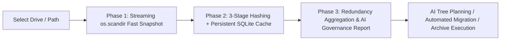

# 🚀 Disk Space Panorama Analyzer & AI Smart Governance System

[](https://www.python.org/downloads/)
[](https://pypi.org/project/PySide6/)
[](https://opensource.org/licenses/MIT)
[](https://www.microsoft.com/windows)
[](https://github.com/xuemingze/disk-space-analyzer)
[-brightgreen.svg)](./tests/)

---

## 📥 Download & Usage

**➡️ [Latest Release (v1.8.0)](https://github.com/xuemingze/disk-space-analyzer/releases/latest)** · [All Releases](https://github.com/xuemingze/disk-space-analyzer/releases) · [Usage & Safety Guide (Chinese)](./docs/使用说明.md)

| Package | Size | Best for | Download |
| --- | ---: | --- | :---: |
| **`DiskSpaceAnalyzer-1.8.0-win64-portable.zip`** | ~80 MB | **Recommended.** Green portable package — unzip anywhere and launch `DiskSpaceAnalyzer.exe`. **No Python installation required.** Instant startup. | [⬇️ Download](https://github.com/xuemingze/disk-space-analyzer/releases/latest/download/DiskSpaceAnalyzer-1.8.0-win64-portable.zip) |
| `DiskSpaceAnalyzer-1.8.0-win64.exe` | ~80 MB | Single-file executable — run directly without manual decompression (fast self-extraction on first boot). | [⬇️ Download](https://github.com/xuemingze/disk-space-analyzer/releases/latest/download/DiskSpaceAnalyzer-1.8.0-win64.exe) |
| Source Archive (`.zip` / `.tar.gz`) | — | Run from source: `pip install -r requirements.txt && python main.py` | [Releases page](https://github.com/xuemingze/disk-space-analyzer/releases/latest) |

> 🖥️ **Operating System**: Windows 10 / 11 64-bit. Precompiled binaries include all necessary runtime components.  
> ⚙️ **Default Storage Paths**: Default archive root is `D:\归档备份` and app migration root is `D:\软件与文件迁移` (safely falls back to `%USERPROFILE%` if no `D:` drive exists). You can customize these at any time in **Settings**.  
> 📝 **Full-Link Crash & Log Persistence**: Standard runtime logs, `error.log` and unhandled exception snapshots are written to `logs/` alongside the application. No silent crashes.

---

> **A High-Performance Windows Desktop System for Deep Disk Space Analysis & Lifecycle Governance**: Anchored by two fundamental architectural tenets — **"AI-First Orchestration Contract"** and **"GUI Invariable Law"**, integrated with the **"Three Core Organizing Principles"**; featuring **2~3 Level Category Tree Skeleton Capture**, **In-Place Path Editing & Sub-Second (<1s) AI Micro-Contract Review with Self-Precipitation**, **Zero-Conflict Double-Click Interaction Model**, **Omnipresent Isomorphic Cascade Synchronization**, **3-Phase Non-Blocking Asynchronous Scanning**, **Automation Center with In-Use Lock Protection**, and **Three Dedup & Merge Governance Modes**.

[English Documentation](./README.md) | [中文说明文档](./README_ZH.md)

---

## 📢 What's New in v1.6.0 (Changelog)

### 🔥 v1.8.0 Major Release (AI-First & Non-Overreach Contract, >100 Items Diagnosis, In-Place Path Preserving Edit, High-Contrast UI)

- 🧠 **Deepened Tenet 1: AI-First & User Sovereignty Contract (Non-Overreach)**:
  - **No Silent Fallback Usurpation**: Corrected the architectural defect where offline heuristic fallbacks would silently overwrite AI summaries on timeout or network exceptions. Enforced "AI as core orchestrator, user decides, zero unauthorized overreach";
  - **Standalone Assets > 100 Architectural Diagnosis Card**: When a scan identifies > 100 discrete standalone assets, the system diagnoses that "there is an 80% likelihood of collective misjudgment" (such as app projects, receipts, VM roles not yet bundled into atomic collectives). Automatically pauses sending mass fragment tokens to AI, preventing prompt explosion and timeouts, and renders a unified OOP decision banner;
  - **Direct Fullscreen Maximized Asset Detail Grid**: Recommended option 1 directly routes to and maximizes the Global Scanned Assets Detail Table (Tab 1), guiding users to right-click and "Promote to Collective" to eliminate fragments at root;
  - **Explicit User Authorization for Forced AI Analysis**: Preserved explicit option to "⚡ Force AI Summary / Organize" at user discretion, strictly prohibiting unauthorized background AI invocation or silent overwriting.
- 🧩 **Unified Object-Oriented Decision Banner Component (`AIDecisionBannerWidget`)**:
  - Encapsulated diagnosis and decision cards into a dedicated reusable component, isomorphically shared between Home View (`HomeView`) and AI Smart Organizer View (`OrganizerView`).
- ✏️ **In-Place Path Preserving Edit & High-Fidelity Fine-Tuning**:
  - **Zero Content Clearing**: Deployed dedicated `PlanningPathItemDelegate` supporting `Qt.EditRole`. When entering edit mode via double-click or `F2`, existing planned paths are 100% pre-filled and highlighted, allowing instant in-place character adjustments or hierarchy modifications before submission.
- 🎨 **High-Contrast UI & Dark Theme Accessibility**:
  - Strictly banned illegible white-on-white and black-on-black text rendering across all tables and tree controls, eliminating alternating zebra striping;
  - Category topology trees overhauled with bright blue (`#38BDF8`), vibrant green (`#10B981`) and deep slate backgrounds with crisp pure-white text (`#F8FAFC`), combined with a locked 44px row height.
- 🛡️ **Shiboken6 C++ Lifecycle & Logging Hardening**:
  - Prevented dangling pointers in logging handlers attached to global loggers when Qt UI widgets are destroyed during teardown or view transitions.
- 🧪 **Enterprise Test Suite Expanded to 116 Tests (100% Passed)**.

---

### 🌲 v1.6.0 Historical Highlights (Category Tree Skeleton Capture & Sub-Second Self-Precipitation)

- 🧠 **Two Foundational Architectural Tenets**:
  - **Tenet 1: AI-First Orchestration Contract**: The local client acts exclusively as the collector of raw physical signatures and the landing executor of structured manifests. The AI model is provided with a standardized micro-contract to orchestrate category trees and validate path edits;
  - **Tenet 2: GUI Invariable Law**: Table row height is permanently locked at **44px** (`verticalHeader().setDefaultSectionSize(44)` + `QHeaderView.Fixed`), completely immune to row-editor or content deformations. UI layouts and toolbar visual styling remain strictly consistent.
- 🌲 **2~3 Level Category Topology Tree & Local Directory Skeleton Capture**:
  - Capture any local exemplar directory structure (e.g. `F:\Ops_Tools`, `D:\Dev_Kits`);
  - **0-Token Fragment Block Technology**: The local scanner extracts directory skeletons and representative executable samples while blocking thousands of fragment files (e.g. cache/logs), drastically reducing prompt size;
  - AI orchestrates and generates standardized 2~3 level hierarchy trees, persisted directly into `global_categories.json`.
- ⚡ **In-Place Path Editing & Sub-Second (<1s) AI Micro-Contract Review**:
  - **In-Table Inline Editing**: Double-click or press `F2` on Column 3 (Target Planned Path) to edit directly in the data grid;
  - **Singleton Keep-Alive Connection Pool**: Integrated singleton `requests.Session` (`pool_connections=20, pool_maxsize=50`), micro-contract prompt <= 150 Tokens, compact JSON output capped at 120 Tokens, slow thinking chain explicitly disabled (`extra_body={"thinking": {"type": "disabled"}}`), **capping end-to-end latency under 1 second (< 1s)**;
  - **Dual Independent Persistence & 5-Tier Priority Stack**: `global_categories.json` and `precipitated_rules.json` persist independently. Match priority: `User Manual Rules (L1) > AI Precipitated Rules (L2) > Category Tree Presets (L3) > Heuristic Rules (L4) > Default Fallback (L5)`. 100% inherited across application restarts.
- 🖱️ **Zero-Conflict Double-Click Interaction Model**:
  - **Column 3 (Planned Target Path)**: Double-click or `F2` triggers inline editing and AI self-precipitation;
  - **All Other Columns (0, 1, 2, 4~7)**: Double-click natively opens and selects the item in Windows File Explorer without any interaction clash.
- 🔄 **Omnipresent Isomorphic Cascade Synchronization**:
  - Real-time instant synchronization across Category Tree Dialog (expand/collapse tree), Data Grid columns (multi-level badge paths), Context Menus (cascading categories), and Space Charts without requiring rescans.
- 🧪 **Enterprise Test Suite**:
  - Comprehensive coverage expanded to **109 tests 100% passed** in ~17s.

---

### 🛡️ v1.5.0 Highlights (Automation Center & 3 Dedup Modes)

- **Automation Center**: Scheduled periodic tasks, background filesystem watching, and **In-Use Lock Protection** to prevent moving active files or programs with running dependencies.
- **Three Duplicate File Governance Schemes**:
  - Mode 1: Safe Archive Mode (retains newest primary copy, archives redundant copies);
  - Mode 2: Zero-Footprint NTFS Hardlink / Junction Mode (instant space reclamation);
  - Mode 3: Atomic Isolated Cleanup with rollback manifests.

---

### 📐 v1.4.0 Highlights (Three Core Organizing Principles)

- **Principle 1: Defensive Recursion Principle (Source Pruning)**:
  - Traversal instantly prunes and bundles narrow atomic entities (portable apps, dev projects, isolated toolchains), blocking millions of fragments from cluttering the scan queue.
- **Principle 2: Broad vs. Narrow Topology Law**:
  - Higher-level semantic dominance for broad container directories (`MovedApps`, `backups`, `Finance`, `Multimedia`), resolving misidentifications.
- **Principle 3: Source Umbrella Consistency**:
  - Preserves source directory naming structures across archive targets, strictly protecting complete backups (`.tar.gz`, etc.).

---

## 🌟 Key Architecture & Highlights

### 1. 🧠 AI-First Orchestration & 2~3 Level Category Tree

```mermaid
flowchart TD
    subgraph Local [Local Feature Extraction & Execution Layer]
        A[Exemplar Directory\ne.g. F:\Ops_Tools] -->|0-Token Fragment Block| B[Skeleton & Representative Executable Samples]
        C[Data Grid\nColumn 3 Target Path] -->|Double-Click / F2 Edit| D[Asset Signatures + Edited Target Path]
    end

    subgraph AI [AI Orchestrator (< 1s Micro-Contract)]
        B -->|Keep-Alive Connection Pool\nPrompt < 150 Tokens| E[AI Category Tree Orchestration]
        D -->|Compact JSON <= 120 Tokens\nThinking Disabled| F[AI Path Audit / Tree Snapping / Rule Abstraction]
    end

    subgraph Storage [Dual Persistence & Cascade Sync]
        E -->|Save| G[(global_categories.json\n2-3 Level Category Tree)]
        F -->|Precipitate| H[(precipitated_rules.json\nPrecipitated Rules DB)]
        G --> I[Omnipresent Sync\nTree Dialog / Multi-Level Badges / Context Menus / Charts]
        H --> I
    end
```

#### Sub-Second (<1s) Guarantee Design:
1. **Singleton HTTP Keep-Alive Pool**: Eliminates TCP/TLS handshakes (`requests.Session` with `pool_connections=20, pool_maxsize=50`);
2. **Compact Micro-Contract Prompt**: Kept under 150 Tokens without conversational clutter;
3. **Capped Generation & Thinking Disabled**: Max tokens capped at 120, `extra_body={"thinking": {"type": "disabled"}}` bypasses slow reasoning chains;
4. **Resilient Local Fallback**: Strict 0.3s connect / 0.5s read timeouts with immediate smooth fallback to local topological rules on network hiccups.

---

### 2. ⚡ 3-Phase Non-Blocking Asynchronous Scan Engine



- **Phase 1 (Instant Scan & Visual Snapshot)**: Rapid `os.scandir` streaming traversal, rendering space distribution charts and **Global Top 100 Large Files Table** in seconds;
- **Phase 2 (Concurrent Chunked Hashing & Duplication Detection)**:
  - 3-stage filtration: `File Size -> 8KB Head Sample Hash -> Full Concurrent File Hash`;
  - Backed by persistent **SQLite Hash Cache** for near-instant repeat scans;
  - 64-bit integer overflow protection for multi-terabyte files;
- **Phase 3 (Redundancy Aggregation & Governance Reports)**: Aggregates duplicates and redundant files into structured Markdown governance reports.

---

### 3. 🖱️ Double-Click Streamlining & GUI Invariable Law

| Column | Interaction | Action Triggered | UX Objective |
| :--- | :--- | :--- | :--- |
| **Column 3 (Planned Target Path)** | Double-Click / `F2` | Activates inline row editor; pressing Enter triggers sub-second AI audit and self-precipitation | Immediate path editing without popups |
| **All Other Columns (0, 1, 2, 4~7)** | Double-Click | Invokes native Windows Explorer to open folder and highlight the target file/directory | Preserves native OS file management ergonomics |

> 📐 **GUI Invariable Law**:  
> Table vertical row height is strictly fixed at **44px** (`verticalHeader().setDefaultSectionSize(44)` and `QHeaderView.Fixed`), immune to font scaling or editor expansion.

---

### 4. 📦 Smart Cross-Disk Migration, NTFS Junction & Rollback

- **NTFS Directory Junction (`mklink /J`)**: Relocate large games or development libraries across drives while maintaining seamless software accessibility;
- **Shortcut & Registry Synchronization**:
  - Automatically identifies associated Desktop and Start Menu `.lnk` shortcuts and re-targets them;
  - Scans `HKCU` / `HKLM` installation and uninstall registry keys, providing selective checkbox updates;
- **Atomic Rollback & Manifest Credentials**:
  - Automatically restores moved assets upon interruption;
  - Stores reversible JSON manifests in `~/.disk_space_analyzer/archive_manifests/` for one-click rollback anytime.

---

### 5. 🤖 Automation Center & In-Use Lock Protection

- **Background Daemon**: Monitors target directories for file events via Windows filesystem notifications;
- **In-Use Lock Protection**: Performs deep file handle inspection before performing archives or deletes, safely skipping active documents or running processes;
- **High Watermark Monitoring**: Alerts when disk usage exceeds safe thresholds and suggests automated cleanups.

---

## 📂 Project Structure

```text
Disk-Space-Analyzer/
├── app/
│   ├── config.py                      # 3-Tier Configuration Manager (Default/Global/Profile)
│   ├── automation/                    # Automation Center Subsystem
│   │   ├── archive_executor.py        # Automated archive executor
│   │   ├── cli_generator.py           # CLI / batch script generator
│   │   ├── manager.py                 # Automation scheduler & task manager
│   │   ├── models.py                  # Automation data models
│   │   ├── quick_organizer.py         # Lightweight fast organizer
│   │   ├── scheduler.py               # Periodic task scheduler
│   │   └── watcher.py                 # Filesystem change observer
│   ├── core/                          # Core Business & Engine Layer
│   │   ├── ai_parser.py               # AI report parser & structure sanitizer
│   │   ├── ai_service.py              # AI orchestrator client, Keep-Alive pool & <1s micro-contract
│   │   ├── app_detector.py            # App identification & atomic grouping engine
│   │   ├── category_manager.py        # 2-3 level category tree & 5-tier precipitation rules
│   │   ├── cleaner.py                 # Streaming archive & safe deletion worker
│   │   ├── hash_cache.py              # SQLite 3-stage persistent hash cache
│   │   ├── migrator.py                # Cross-disk migration, NTFS Junction & shortcut/registry sync
│   │   ├── rollback_worker.py         # Atomic rollback worker & manifest engine
│   │   ├── scanner.py                 # 3-phase asynchronous scanning engine
│   │   └── task_manager.py            # Unified task scheduler (speed/ETA/pause/resume)
│   ├── ui/                            # Modern PySide6 Desktop GUI
│   │   ├── main_window.py             # Sidebar main window frame
│   │   ├── home_view.py               # Scan dashboard & space distribution view
│   │   ├── organizer_view.py          # AI organizer view & tree planning
│   │   ├── settings_view.py           # Settings center (3-tier config, models, ignore paths)
│   │   ├── styles.py                  # Modern dark theme stylesheet
│   │   ├── components/                # Reusable UI Components
│   │   │   ├── category_dialog.py     # 2-3 level category tree & exemplar capture wizard
│   │   │   ├── data_table.py          # 44px fixed row height data grid with inline editing
│   │   │   ├── migration_dialog.py    # Cross-disk migration wizard & sync dialog
│   │   │   ├── organize_dialog.py     # 10-column directory tree planning dialog
│   │   │   └── task_manager_widget.py # Background task monitor & diagnostic dialog
│   │   └── dedup/                     # Duplicate File 3-Scheme Wizard
│   │       ├── dedup_merge_view.py    # Dedup & merge container view
│   │       ├── directory_select_step.py # Directory selection step
│   │       ├── scan_progress_step.py  # Hashing progress step
│   │       ├── review_table_step.py   # Review table step
│   │       └── merge_execute_step.py  # Merge execution step
│   └── utils/
│       ├── file_helper.py             # Whitelist & size formatters
│       ├── lock_detector.py           # File/process handle lock protection (In-Use Guard)
│       └── logger.py                  # Rolling logging system & crash snapshot hooks
├── tests/                             # Test Suite (109 Tests 100% Passed)
│   ├── test_category_tree_and_self_precipitation.py # Category tree, <1s micro-contract & in-place edit tests
│   ├── test_restart_inheritance_and_select_recommended.py # Restart inheritance & checkbox tests
│   ├── test_three_core_principles_unified.py       # Three Core Organizing Principles tests
│   ├── test_automation_center.py                   # Automation Center & in-use protection tests
│   ├── test_dedup_and_merge.py                     # 3 dedup schemes tests
│   ├── test_collective_promotion_and_app_manager.py# Collective promotion tests
│   ├── test_ai_service_and_pipeline.py             # AI client, sanitization & retry tests
│   └── ...                                         # Additional regression tests (see tests/)
├── build_release.py                   # One-click PyInstaller release packager
├── main.py                            # Application entrypoint
├── requirements.txt                   # Production runtime dependencies
└── requirements-dev.txt               # Development & testing dependencies
```

---

## 🚀 Quick Start

### 1. Prerequisites & Installation
Python 3.10 or higher is recommended:
```bash
# 1. Clone repository
git clone https://github.com/xuemingze/disk-space-analyzer.git
cd disk-space-analyzer

# 2. Create and activate virtual environment (Recommended)
python -m venv .venv
.venv\Scripts\activate

# 3. Install dependencies
pip install -r requirements.txt
```

### 2. Launch GUI Application
```bash
python main.py
```

### 3. Run Automated Test Suite
```bash
# Run all 116 unit and integration tests (~17s)
python -m pytest tests/ -v
```

---

## 🤖 LLM Configuration Guide

Navigate to **"Settings"** in the sidebar:
1. **Base URL**: Enter any OpenAI-compatible API endpoint (e.g. `https://api.openai.com/v1`, DeepSeek `https://api.deepseek.com/v1`, MiniMax, Qwen, or local Ollama `http://localhost:11434/v1`).
2. **API Key**: Enter your API key.
3. **Model Selection**: Click **"🔄 Fetch Available Models"** to populate available models.
4. **Test & Save**: Click **"⚡ Test Connection"** to verify, then save to Global or Profile configuration.

> 💡 **Offline Fallback Guarantee**:  
> If no API Key is configured or network is disconnected, the client seamlessly falls back to the high-accuracy offline heuristic rule engine, ensuring 100% operational availability.

---

## 🩺 Diagnostics & Troubleshooting

Global exception handlers monitor main, worker, and interpreter exit threads:

| Log File | Purpose | Rolling Policy |
| :--- | :--- | :--- |
| `logs/app.log` | Standard runtime logs & scan events | 2 MB per file, max 3 files |
| `logs/error.log` | Warning & error stack traces | 1 MB per file, max 5 files |
| `logs/crash-*.log` | Dedicated snapshot for uncaught exceptions | Preserved permanently |

When reporting issues, please attach `logs/error.log` or the latest `logs/crash-*.log`.

---

## 📄 License

This project is licensed under the [MIT License](LICENSE).
