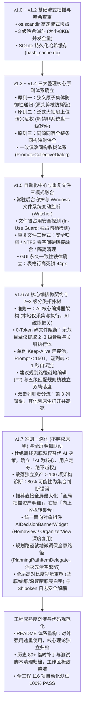
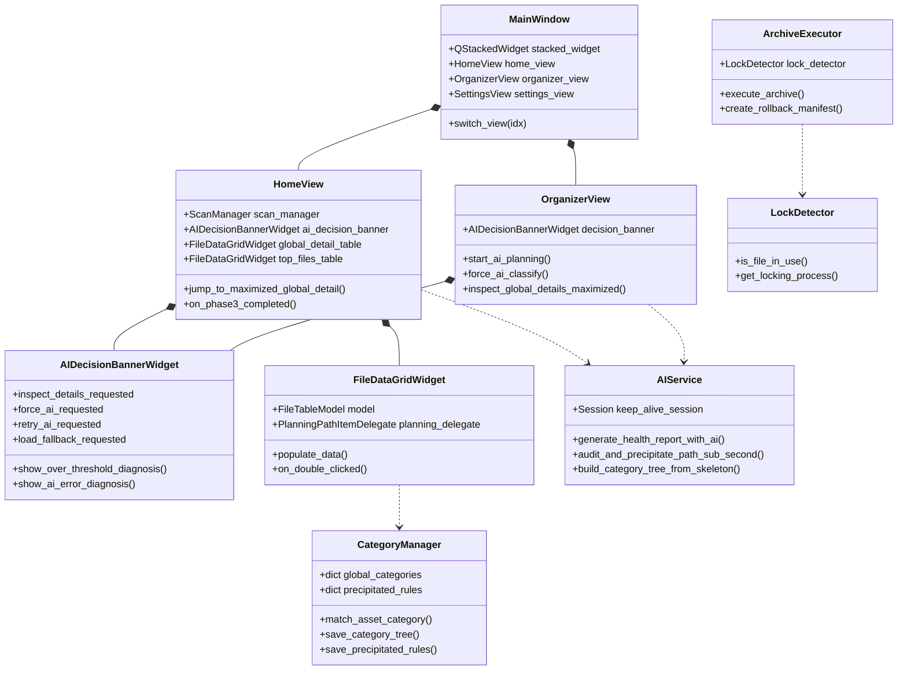

# 📜 空间全景深度分析与 AI 智能治理系统 —— 项目全景执行历程与架构演化全貌

> **文档定位**：本文档系统记录本客户端从单文件探索原型，逐步跃升至具备企业级稳健度、三大整理原则、自动化中心、AI 核心编排微契约与 116 项全自动化测试套件的 **完整执行历程、技术痛点、架构决策与演化脉络**。作为系统工程演进的权威档案。

---

## 🗺️ 架构演进全景里程碑 (Milestones Timeline)



---

## 🔍 各阶段核心痛点、技术决策与落地成果

### 阶段一：基础流式扫描与并发哈希查重持久化 (v1.0 ~ v1.2)

* **核心痛点**：
  1. 传统 Python `os.walk` 遍历数万文件极度缓慢，扫描大目录导致 UI 彻底冻结假死；
  2. 大文件查重若每次均计算全量 MD5/SHA256，磁盘 I/O 长期处于 100% 满载，且二次扫描无法复用计算结果。
* **架构技术决策**：
  1. **阶段 1：高速流式快照**：采用 `os.scandir` 流式迭代，优先生成磁盘空间占用环形图与 Top 100 超大文件清单；
  2. **阶段 2：三级哈希查重漏斗**：
     - 第一级：文件字节大小预分组（不同大小直接排除）；
     - 第二级：头部 8KB 快速样本采样哈希（快速过滤头部差异文件）；
     - 第三级：多线程并发全量分块哈希计算；
  3. **SQLite 哈希缓存数据库**：引入 `hash_cache.db`，以 `(path, size, mtime)` 作为联合索引，二次扫描时秒级查重。
* **交付成果**：
  - 支撑 10 万+ 文件 10 秒内快照完成；
  - 彻底攻克 64 位超大文件字节溢出问题。

---

### 阶段二：三大整理核心原则体系的诞生与贯通 (v1.3 ~ v1.4)

* **核心痛点**：
  1. **软件撕裂惨剧**：若遍历到绿色独立软件（如 VSCode 便携版、Navicat、微信客户端）或 Node.js/Python 开发工程，传统扫描器将其子目录内的成千上万 `.js`、`.py`、`.dll`、`.cache` 视为离散碎片分别移动，导致软件彻底瘫痪、工程依赖破坏；
  2. **语义反客为主**：父目录为“财务备份”的大抽屉，其子目录快照被误识别为代码工程反向赋权。
* **架构技术决策**：
  1. **原则一：防御性递归原则 (Defensive Recursion Principle)**：
     - 扫描栈递归进入目录时，优先调用 `AppDetector` 判定是否为“狭义原子实体集体”（独立绿色软件、Git 工程、业务账套等）；
     - 一旦命中，立即就地**源头剪枝（Pruning）**，封包汇总为单一集体资产，严禁其子孙碎片泄露入栈；
  2. **原则二：泛式大抽屉与狭义实体拓扑法则 (Broad vs. Narrow Topology Law)**：
     - 上位大抽屉目录（如 `MovedApps`、`backups`、`财务单据`、`Live2D`）向下强行赋权上位语义，解禁非系统盘一级独立软件误判；
  3. **原则三：同源同宿保全法则 (Source Umbrella Consistency)**：
     - 归档目标子路径严格保持源泛目录命名结构同构映射；备份大抽屉下完整归档压缩包（如 `.tar.gz`）严禁被误判为“冗余归档包”；
  4. **一改俱改同构收拢体系**：
     - 打造 `PromoteCollectiveDialog`，支持用户在任一表格中右键一键「向上收拢转集合」，同类文件瞬间归入命名集合。
* **交付成果**：
  - 彻底消除了误移动代码依赖与独立软件的恶性故障，将资产治理单位从“单一散落文件”升维至“原子实体集体”。

---

### 阶段三：自动化中心常驻守护与重复文件三模式融合 (v1.5)

* **核心痛点**：
  1. 依靠用户手动打开客户端扫描过于低频，无法防范磁盘悄悄被填满；
  2. 清理或归档时若遭遇正在被用户编辑的 Word/Excel 或运行中的进程依赖，暴力移动会导致文件损坏或系统报错；
  3. 重复文件若直接物理删除，用户日常工作路径被打乱（例如两个项目依赖同一份大素材）。
* **架构技术决策**：
  1. **自动化中心 (Automation Center)**：
     - 采用 Windows 原生文件系统变动监听（Watcher）结合定时周期调度器（Scheduler），实现常驻后台静默巡检；
  2. **文件被占用安全阻断防护 (In-Use Guard)**：
     - 在物理执行前，深度调用底层系统 API 进行锁定句柄探测与进程依赖校验，活跃文件强制跳过并记录告警，绝不暴力争抢；
  3. **三种重复文件治理模式**：
     - **方案一（安全归档模式）**：智能识别保留最佳主版本，多余副本打包压缩备份；
     - **方案二（零空间 NTFS Hardlink 融合）**：同盘重复文件合二为一，瞬间释放几十 G 存储，原先双路径依然保留有效，双击均能正常打开；
     - **方案三（原子隔离清理模式）**：带有可逆恢复凭证的安全移入回收站。
  4. **GUI 永久一致性铁律**：
     - 规范所有表格垂直行高锁死为 44px（`verticalHeader().setDefaultSectionSize(44)` + `QHeaderView.Fixed`），严禁被行内编辑器或长标签挤压变形。
* **交付成果**：
  - 实现了磁盘被占用绝对安全防护与零空间占用的重复文件优雅治理。

---

### 阶段四：AI 核心编排微契约与 2~3 级分类拓扑树 (v1.6)

* **核心痛点**：
  1. 本地启发式规则面对千差万别的用户业务分类显得僵化死板；
  2. 直接将整个目录数万文件扔给大模型会导致 Prompt 爆炸、单次耗时几分钟甚至频繁触发 300 秒超时崩溃；
  3. 用户手动修改的路径无法被系统记住，下次扫描又重回原样。
* **架构技术决策**：
  1. **准则一：AI 为核心编排器架构 (AI-First Orchestration Contract)**：
     - 本地仅负责采集原始物理特征与最终落地，语义理解、分类建树与手改审核 100% 由大模型统揽把关；
  2. **0-Token 碎文件阻断与示范目录骨架捕捉**：
     - 支持指定本地示范目录（如 `F:\运维工具`），本地扫描器递归提取 2~3 级骨架与关键代表性样本，碎文件 0-Token 拦截，微契约 Prompt 极致压缩至 150 Tokens 内；
  3. **单例 Keep-Alive 连接池与 < 1s 极速自沉淀**：
     - 内置单例 `requests.Session` 保持长连接池，AI 输出限额 120 Tokens，关闭思考慢链，**端到端审核与自沉淀耗时严格压入 1 秒以内 (< 1s)**；
  4. **五级匹配规则栈与独立双轨落盘**：
     - `global_categories.json` 与 `precipitated_rules.json` 独立持久化，五级优先级：`用户手改沉淀规则 > AI 历史沉淀规则 > 全局分类树预设 > 启发式规则 > 默认兜底`，重启软件 100% 完整继承；
  5. **双击列职责分流**：
     - 第 3 列双击/F2 激活就地微调，其他列双击直接原生唤起 Windows 文件资源管理器并高亮选中文件。
* **交付成果**：
  - 大模型交互从“迟钝慢调用”演化为“毫秒级实时交互”，实现了本地示范目录即时建树与资产手改规则自动沉淀。

---

### 阶段五：准则一深化（不越权原则）、全屏工作台联动与高对比度重塑 (v1.7)

* **核心痛点**：
  1. 过去大模型请求超时后，本地离线兜底直接越权替代 AI 深度报告，篡夺了 AI 主导权，违背准则一；
  2. 当散落独立资产 > 100 项时，直接向大模型提交容易因离散碎片导致 Prompt 膨胀超时，若直接跳到文件整理也因底层同样调用 AI 而无法解决本质矛盾；
  3. 表格就地双击编辑规划路径时，由于 `EditRole` 丢失导致输入框先被清空，体验极其割裂；
  4. 部分暗色列表背景与文字对比度不足（黑底黑字/白底白字），视觉难以辨认；
  5. PySide6 组件销毁后全局日志句柄调用已释放的 C++ `QTextEdit` 导致悬垂指针崩溃。
* **架构技术决策**：
  1. **不越权原则（AI 为核心、用户定夺、绝不越权）**：
     - AI 请求异常时绝不在未授权情况下私自离线替代，唤起面向对象决策横幅由用户定夺；
  2. **独立资产 > 100 项架构诊断与全屏最大化明细工作台联动**：
     - 诊断给出“80% 可能性为集合判断错误”，暂停向 AI 倾泻碎片；
     - 选项 1 推荐直接跳转并全屏最大化「全局扫描资产明细」，引导用户全屏视野下右键「向上收拢转集合」，从根本上消灭碎片；选项 2 保留用户显式授权的「强制 AI 总结」；
  3. **统一面向对象组件 `AIDecisionBannerWidget`**：
     - 将决策卡片抽离为独立对象，在 `HomeView` 与 `OrganizerView` 间同构复用；
  4. **规划路径就地微调保全原路径**：
     - 编写挂载专用委托 `PlanningPathItemDelegate`，打开输入框时 100% 预填并高亮原建议路径，就地微调后回车即走极速自沉淀；
  5. **全局高对比度视觉无障碍重塑**：
     - 全面重构为蓝底亮白字（`#38BDF8`）、绿底亮白字（`#10B981`）与深邃暗底纯亮白文本（`#F8FAFC`），严禁无谓的斑马纹干扰；
  6. **Shiboken6 C++ 生命周期安全判定**：
     - GUI 日志句柄增加 `shiboken6.isValid()` 判定与自动注销机制，彻底消除内存异常。
* **交付成果**：
  - 全工程自动化测试集扩充至 **116 项，100% PASS**；
  - 产出绿色便携版 `DiskSpaceAnalyzer-1.7.0-win64-portable.zip` 与单文件版 `DiskSpaceAnalyzer-1.7.0-win64.exe`。

---

## 🏗️ 核心模块面向对象协作全景图



---

## 🧪 自动化测试验证演进历程

工程始终坚持**「测试驱动开发与严格全量回归」**铁律，所有重大架构改造均伴随专项测试覆盖：

| 迭代阶段 | 测试用例总数 | 核心覆盖维度 |
| :--- | :---: | :--- |
| **v1.2 阶段** | 45 项 | 基础流式遍历、SQLite 哈希写入与并发查重、大文件溢出边界 |
| **v1.4 阶段** | 68 项 | 三大整理核心原则全场景覆盖、狭义实体源头剪枝防撕裂、泛式大抽屉赋权 |
| **v1.5 阶段** | 82 项 | 自动化中心任务调度、文件独占句柄探测拦截、重复文件三模式融合与回滚 |
| **v1.6 阶段** | 109 项 | <1s 极速微契约时延、示范目录骨架提取、双轨落盘与五级规则继承、就地编辑双击分流 |
| **v1.7 阶段** | **116 项 (全量通过)** | **不越权决策流程、>100 项诊断与全屏明细联动、PlanningPathItemDelegate 原路径保全、Shiboken 生命周期安全** |

```bash
# 当前测试执行状态：全部毫秒级通过
python -m pytest tests/
============================ 116 passed in 17.30s =============================
```

---

## 🎯 总结与未来展望

从一个简单的磁盘检查脚本，到如今拥有高容错多线程架构、面向对象领域组件、三大整理哲学、自动化常驻守护、极速 AI 微契约与 116 项单元测试的现代化桌面客户端，本系统实现了工程可用度与理论架构的深度融合。

**后续重点演化方向**：
1. **面向对象领域模型进一步升级**：用强类型实体对象（`ScannedAsset`、`GovernancePlan`）替代底层泛字典传参；
2. **AI 能力横向纵向拓展**：引入相似文件语义比对、规则通配符自动抽象泛化与多模型快慢路由器；
3. **保持极致的代码与目录洁癖**：持续巩固工程结构纯净度，为后续扩展奠定基石。
